# Autonomous-FinOps — Architecture Notes

**Updated:** 2026-11-20
**Scope:** how `version-5/` works today, and the target architecture it is moving to.
**Companion doc:** [PRODUCT_PLAN.md](PRODUCT_PLAN.md) (phases, tasks, risks).

Diagrams are written in [Mermaid](https://mermaid.js.org/), which renders on GitHub, GitLab and in VS Code (with the Markdown Preview Mermaid extension).

---

## Contents

**Part A — Current system (version-5 as copied from version-4)**
1. [System context](#1-system-context-today)
2. [Components](#2-components-today)
3. [Request lifecycle: upload → dashboard](#3-request-lifecycle-today)
4. [Data preprocessing & features](#4-data-preprocessing--feature-engineering)
5. [Zombie detection ensemble](#5-zombie-detection-ensemble)
6. [Forecasting (LSTM)](#6-forecasting-lstm)
7. [Savings & recommendations](#7-savings--recommendations)
8. [Known architectural problems](#8-known-architectural-problems)

**Part B — Target product architecture**

9. [Target system context](#9-target-system-context)
10. [Target containers](#10-target-containers)
11. [Code layering](#11-code-layering)
12. [Async analysis flow](#12-async-analysis-flow)
13. [Data model](#13-data-model)
14. [Finding lifecycle](#14-finding-lifecycle)
15. [Cloud connectors](#15-cloud-connectors)
16. [Multi-tenancy & security](#16-multi-tenancy--security)
17. [Deployment on AWS](#17-deployment-on-aws)
18. [CI/CD](#18-cicd)
19. [Migration path from version-5](#19-migration-path)

---

# Part A — Current system

> **Status (2026-11-25):** Part A describes the version-4 design that version-5
> started from. Phase 1 has since changed the engine: findings are per
> **resource** (`finops_core/resources.py`: idle / overpriced / ml_outlier
> signals, waste = cost above the peer median), the row ensemble in §5 is only a
> supporting signal with its confidence bug fixed, and the request path uses the
> statistical forecast in `forecast_baseline.py` instead of training the LSTM in
> §6 (now offline-only). Problems 1–4 in §8 are resolved; see
> [PRODUCT_PLAN.md](PRODUCT_PLAN.md) Phase 1 for details.

## 1. System context (today)

One user, one machine, a manual CSV upload. Nothing is stored except the uploaded file.

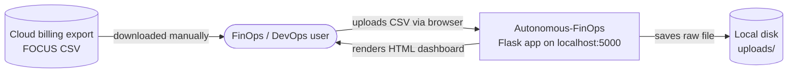

## 2. Components (today)

| File | Lines | Responsibility |
|---|---|---|
| `version-5/interface.py` | 674 | Flask app, routes, **fallback copy** of preprocessing/detection/forecasting, matplotlib plotting, recommendation rules, result formatting |
| `version-5/ml.py` | 886 | `DataPreprocessor`, `OptimizedZombieDetector`, `AdvancedForecaster`, and `main_training_pipeline()` (offline script that writes `finops_artifacts/`) |
| `version-5/templates/` | — | `finOps.html` (landing), `index.html` (upload), `dashboard.html` (results) — Bootstrap 5, dark theme |
| `version-5/finops_artifacts/` | — | Saved models from an offline run: `zombie_model.pkl`, `zombie_scaler.pkl`, `forecast_lstm.keras`, `forecast_scalers.pkl`, `training_metadata.json` — **not loaded by the web app** |

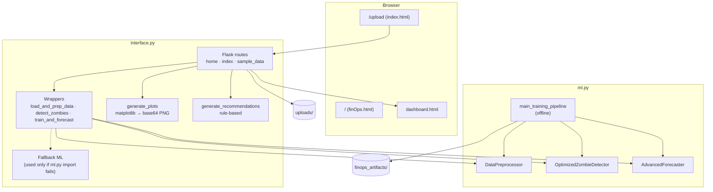

## 3. Request lifecycle (today)

Everything happens **synchronously inside one HTTP POST**, including training three Isolation Forests and an LSTM.

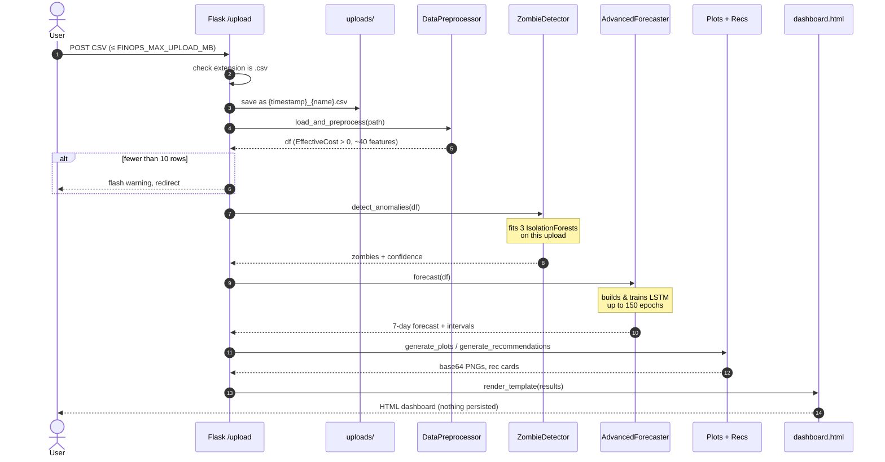

## 4. Data preprocessing & feature engineering

`DataPreprocessor.load_and_preprocess()` in `ml.py`:

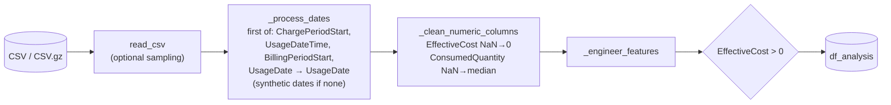

Feature groups produced by `_engineer_features`:

| Group | Features |
|---|---|
| Log / ratio | `LogCost`, `LogUsage`, `CostPerUnit`, `LogCostPerUnit`, `CostUsageRatio`, `UsageCostRatio`, `LogCostRatio` |
| Statistical | `CostZScore`, `UsageZScore`, `CostPercentile`, `UsagePercentile`, `IsCostOutlier`, `IsUsageOutlier` (IQR) |
| Interaction / polynomial | `CostUsageInteraction`, `CostUsageDiff`, `CostUsageSum`, `CostSquared`, `UsageSquared` |
| Temporal | `DayOfWeek`, `DayOfMonth`, `Month`, `Quarter`, `IsWeekend`, `DayOfWeekSin/Cos`, `MonthSin/Cos`, `IsStartOfMonth`, `IsEndOfMonth` |
| Service context | `ServiceCategoryEncoded`, `ServiceFrequency`, `CostVsServiceMean`, `UsageVsServiceMean` |
| Rolling | `CostVsRollingMean` (when > 7 rows) |

> Only `UsageDate`, `ServiceCategory`, `EffectiveCost`, `ConsumedQuantity` are used. Rich FOCUS columns such as `ResourceId`, `SubAccountId`, `RegionId`, `Tags`, `ChargeCategory` are ignored.

## 5. Zombie detection ensemble

`OptimizedZombieDetector.detect_anomalies()`:

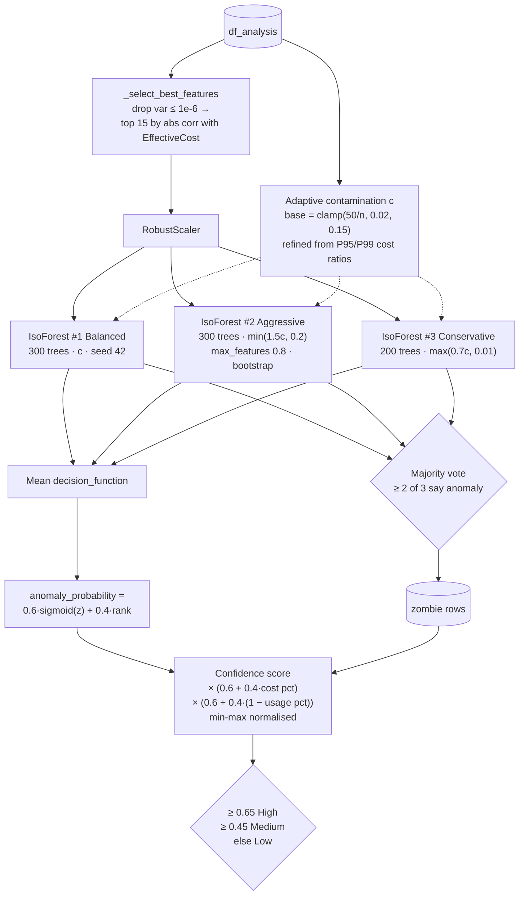

**Waste definition today:** `total_waste = Σ EffectiveCost of zombie rows`. Because each flagged row counts in full, waste can be very high (51% on the 229k-row dataset in `training_metadata.json`).

## 6. Forecasting (LSTM)

`AdvancedForecaster(lookback_window=14, forecast_days=7)`:

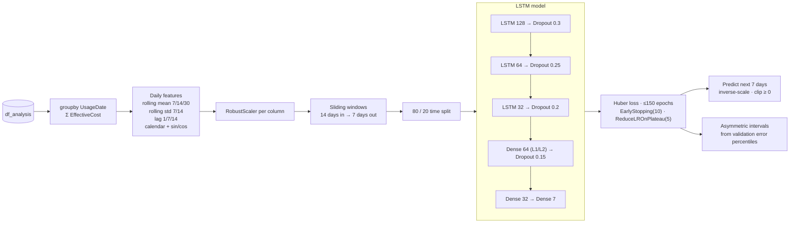

Short histories fall back to simpler outputs (e.g. average daily cost) when there aren't enough days to build sequences.

## 7. Savings & recommendations

In `interface.py`, after detection and forecast:

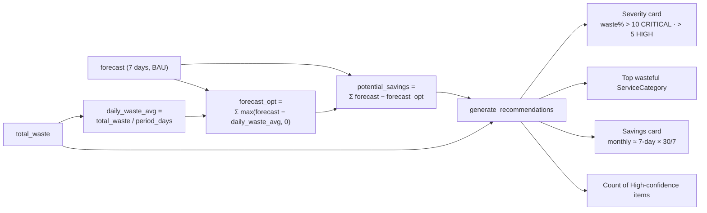

## 8. Known architectural problems

| # | Problem | Effect | Fixed in (target) |
|---|---|---|---|
| 1 | ML training runs inside the HTTP request | Slow uploads, timeouts on big files, one user blocks a worker | §12 async worker |
| 2 | Saved artifacts never used by the app | Every upload re-trains from scratch; no consistent model version | §12, model registry |
| 3 | Fallback ML duplicated in `interface.py` | Two implementations drift | §11 single `finops_core` |
| 4 | Row-level anomalies, waste = full row cost | Inflated waste %, findings aren't actionable resources | §13 resource-level `Finding` |
| 5 | No persistence | No history, trends, or savings tracking | §13 data model |
| 6 | No auth / tenancy | Single user only, shared `uploads/` dir | §16 |
| 7 | Server-side matplotlib PNGs | Heavy responses, no interactivity | JSON API + client charts |
| 8 | `print()` logging, no tests | Hard to operate and change safely | §18 CI |

---

# Part B — Target product architecture

## 9. Target system context

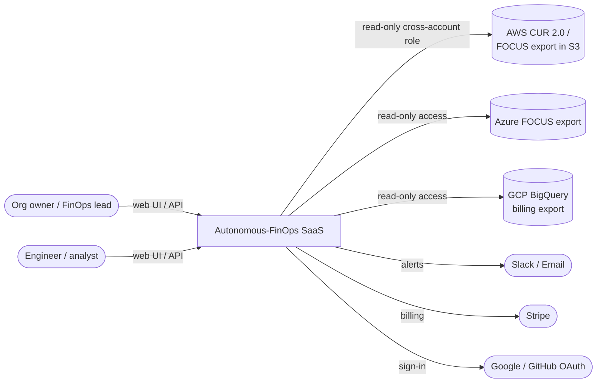

## 10. Target containers

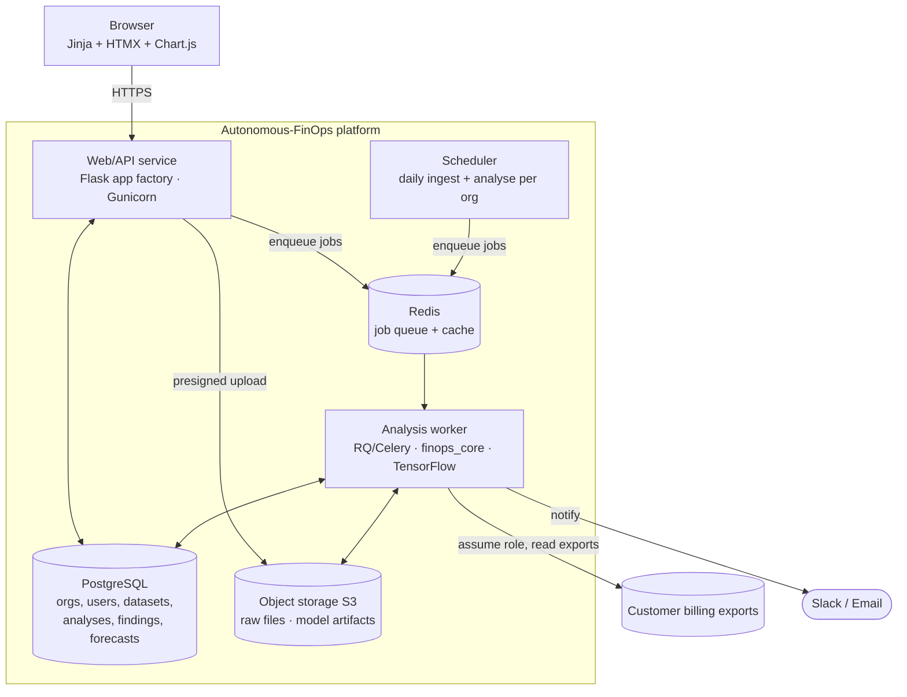

| Container | Scales by | Notes |
|---|---|---|
| Web/API | request rate | Stateless; no ML imports, so a small image |
| Worker | queue depth | Heavy image with pandas/sklearn/TensorFlow; concurrency limited per org |
| Scheduler | single instance | Could be EventBridge Scheduler on AWS instead of a process |
| PostgreSQL | vertical, read replica later | Every table carries `org_id` |
| Redis | small | Queue and short-lived caches only, not a source of truth |
| S3 | — | Keys prefixed `org/{org_id}/…`, SSE encryption, lifecycle rules |

## 11. Code layering

Dependencies point **inwards only**. `finops_core` knows nothing about Flask, the DB or S3.

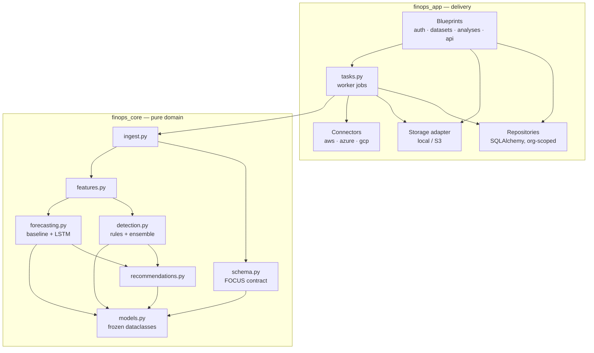

Where today's code goes:

| Today | Target |
|---|---|
| `DataPreprocessor._process_dates / _clean_numeric_columns` | `finops_core/ingest.py` + `schema.py` |
| `DataPreprocessor._engineer_features` | `finops_core/features.py` |
| `OptimizedZombieDetector` | `finops_core/detection.py` (plus new rule-based detectors) |
| `AdvancedForecaster` | `finops_core/forecasting.py` (behind a `Forecaster` protocol, with a naive baseline) |
| `generate_recommendations` | `finops_core/recommendations.py` |
| `generate_plots` | removed; the API returns JSON and charts render in the browser |
| fallback ML in `interface.py` | deleted |
| routes in `interface.py` | `finops_app/*` blueprints |

## 12. Async analysis flow

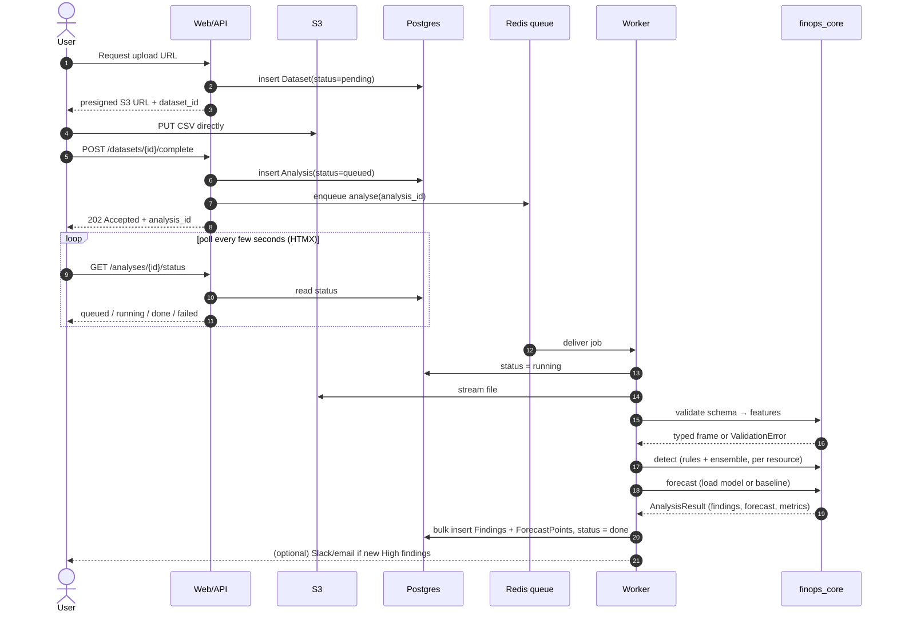

Failure handling: the worker catches exceptions, stores a user-safe message on `Analysis.error`, logs full context, and retries transient errors (S3/DB) with backoff. Validation errors are not retried.

## 13. Data model

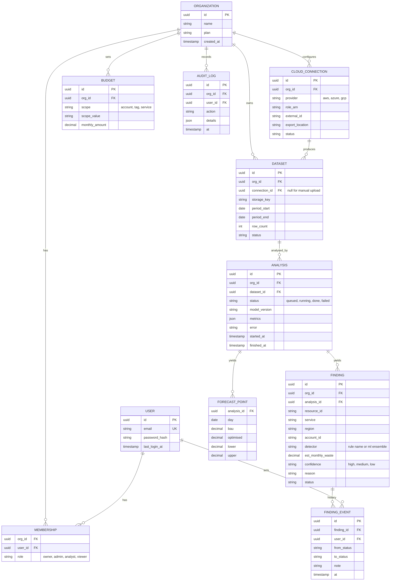

Findings are de-duplicated across analyses by `(org_id, resource_id, detector)` so a resource that stays idle shows as one open finding with history, not a new row every day.

## 14. Finding lifecycle

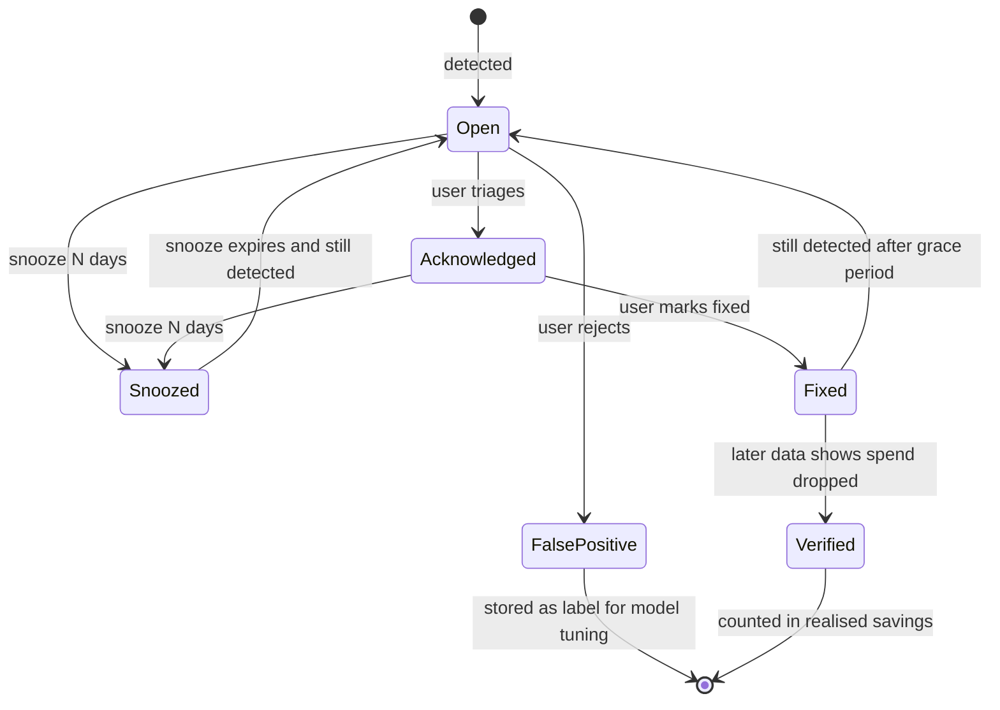

## 15. Cloud connectors

AWS is first. The customer creates a read-only role; we never store their access keys.

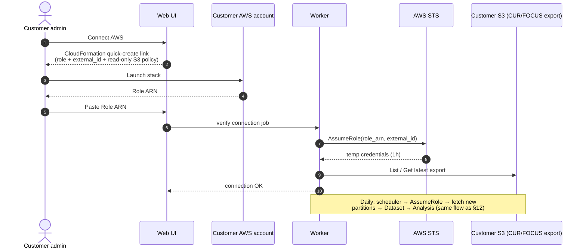

## 16. Multi-tenancy & security

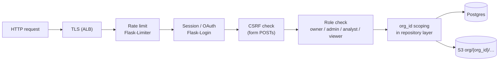

Rules:
- `org_id` comes from the session, never from request parameters.
- Every repository method requires `org_id`; there is no unscoped query helper.
- Uploaded files: size cap, `.csv`/`.csv.gz` only, sniffed content, row cap per plan, parsed only in the worker.
- Secrets (`FINOPS_SECRET_KEY`, DB URL, Stripe keys) come from env / AWS Secrets Manager; the app refuses to start in prod without them.
- Security headers via Flask-Talisman (CSP, HSTS); no server-built HTML passed through `|safe`.
- Audit log for logins, role changes, connection changes and finding status changes.

## 17. Deployment on AWS

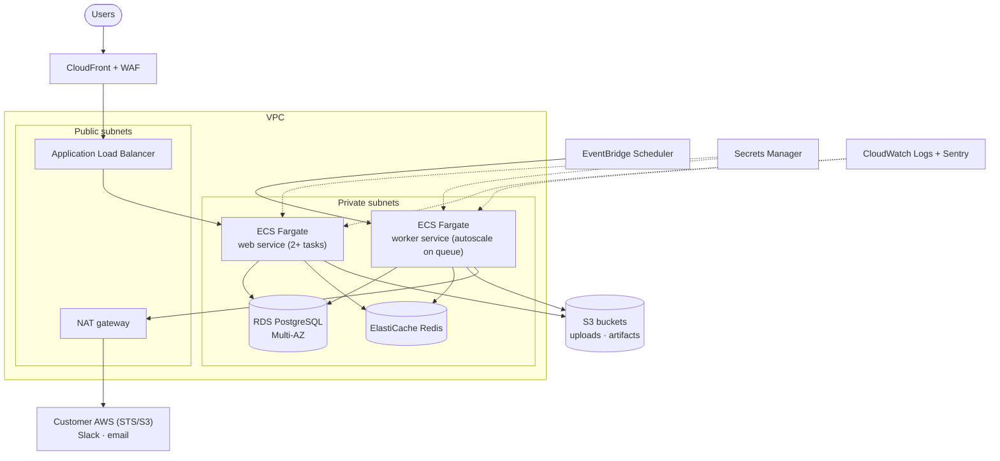

For early users a cheaper single-region setup also works: one small Fargate service per role, a db.t4g Postgres, and no CloudFront. Fly.io/Render with managed Postgres + Redis is the low-ops alternative.

## 18. CI/CD

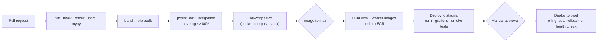

## 19. Migration path

How version-5 gets from Part A to Part B without a big-bang rewrite. Each step keeps the app runnable.

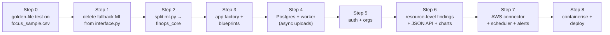

Mapping to the plan: steps 0–1 are Phase 0, step 2 is Phase 1, steps 3–4 are Phase 2, step 5 is Phase 3, step 6 is Phases 1 and 4, step 7 is Phase 5, and step 8 is Phase 6 in [PRODUCT_PLAN.md](PRODUCT_PLAN.md).
